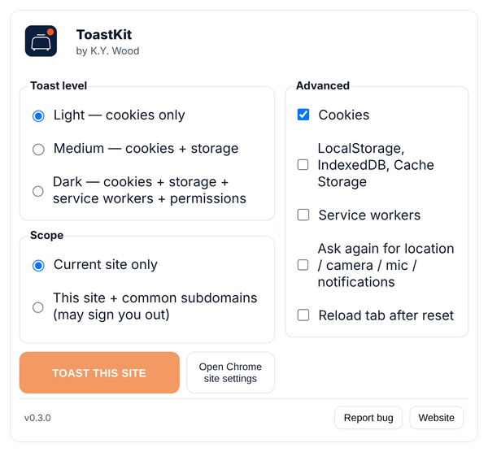
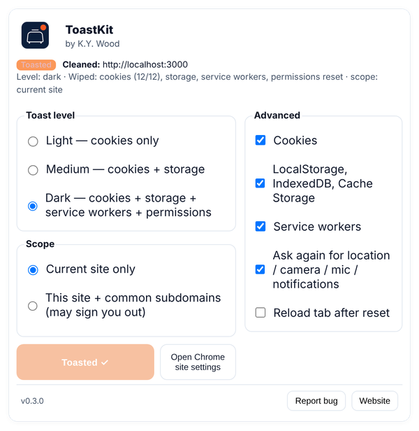

<p align="center">
  
</p>

# ToastKit

A browser extension for Chrome and Firefox that resets one site without touching the rest of your browser.

I built it because I kept needing a clean slate on one domain while testing, and clearing everything meant signing back in to everything else. ToastKit clears the site you're on and leaves every other tab and login alone.

[Chrome Web Store](https://chromewebstore.google.com/detail/toastkit/elejhggeniacnbiaefebpehiepmbokam) · [What it stores](https://kimberly-wood.com/privacy/#browser-extensions)

## How it works

Pick a level:

- **Light** clears cookies
- **Medium** also clears localStorage, IndexedDB and Cache Storage
- **Dark** also removes service workers and sets location, camera, microphone and notifications back to "ask"

You can change any of those under Advanced, and have it reload the tab when it's done.

Scope is either the current site, or the current site plus its parent domain and the usual subdomains (www, mail, account, auth, login). The wider one will probably sign you out.

After a reset it tells you what it cleared, including how many cookies it removed.

Alt+T does a Dark reset of the current site without opening the popup.

| Popup | After a reset |
|:--:|:--:|
|  |  |

## What it keeps

Just your settings: level, scope and the Advanced checkboxes. They're in the browser's sync storage, so they follow you to other machines if you use Chrome sync or Firefox Sync. It doesn't keep a list of sites you've reset and doesn't send anything anywhere.

## Permissions

- `browsingData`, to clear storage and service workers for the site
- `cookies`, to count and remove the site's cookies
- `contentSettings`, to reset the site's permissions
- `storage`, for your settings
- Access to http and https sites, which the cookie and permission APIs need
- In Firefox only, `scripting`, to clear storage from inside the page (below), and no `contentSettings`

## Running it from source

1. Clone the repo.
2. Go to `chrome://extensions/` and turn on Developer mode.
3. Click Load unpacked and pick the folder.

In Firefox:

1. Run `npm run package` (it needs the `zip` command).
2. Go to `about:debugging#/runtime/this-firefox`.
3. Click Load Temporary Add-on and pick `dist/toastkit-<version>-firefox.zip`. It stays until you close Firefox.

## Firefox

The code is the same in both browsers and `npm run package` builds both store zips from the one `manifest.json`. Firefox's extension APIs differ in a few places, so a few things work differently there:

- **Permissions.** Firefox has no API for resetting a site's permissions, so the popup leaves that option out and Dark is cookies, storage and service workers. To reset them, use the icon to the left of the address.
- **Storage.** Firefox can only clear storage by host name, which takes every port with it, and in testing it didn't clear anything for an address with a port. So ToastKit clears the page's own localStorage, IndexedDB, Cache Storage and service workers from inside the page, exact to the origin like in Chrome. With the wider scope, the other hosts are cleared by host name, which covers localStorage, IndexedDB and service workers but not Cache Storage.
- **Containers and private windows.** Cookies are cleared in the container or private window the tab is in, and the same site elsewhere is left alone. Cookies kept apart by first-party isolation are found too.
- **Access to websites.** Firefox doesn't give an extension access to websites until you allow it, and lets you take it away later. Without it ToastKit can't touch cookies, so the popup says so and shows an Allow access button, and Alt+T puts a ! on the toolbar button instead of the usual tick.

## Tests

The tests load the extension into a real Chromium and check that a reset clears one site completely (including sites on a port) and leaves other sites alone, and which domains each scope covers. A second set loads the Firefox build into real Firefox and checks the same, plus ports, containers, the wider scope and the access prompt. Both run on every push.

```
npm ci
npx playwright install chromium
npm test
npm run test:firefox   # needs Firefox and geckodriver installed
```

You don't need any of this to use or load the extension.

## Bugs and security issues

Bugs go in [issues](https://github.com/yvon-l/toastkit/issues). For anything security related, use [private reporting](https://github.com/yvon-l/toastkit/security/advisories/new) instead. More in [SECURITY.md](SECURITY.md).

MIT license. Built by K.Y. Wood.
